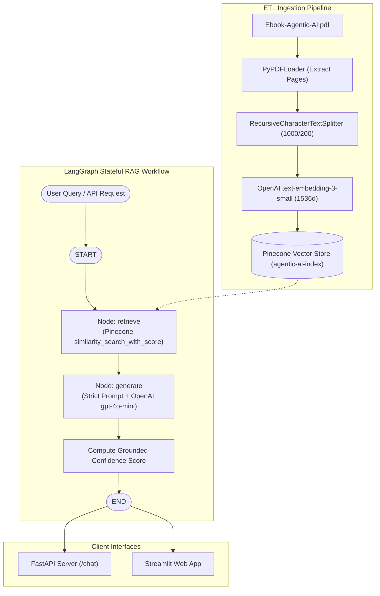

# 🤖 Agentic AI RAG Chatbot

A production-ready **Retrieval-Augmented Generation (RAG)** chatbot strictly grounded in the **Agentic AI eBook**. Built using **Python 3.12**, **LangGraph**, **Pinecone Vector Database**, **FastAPI**, and **Streamlit**.

The chatbot guarantees strict grounding: it only answers queries using information retrieved from the source document, refusing out-of-domain questions with a zero confidence score.

---

## 📑 Table of Contents

- [Key Features](#-key-features)
- [System Architecture](#-system-architecture)
- [Directory Structure](#-directory-structure)
- [Prerequisites](#-prerequisites)
- [Step-by-Step Setup Guide](#-step-by-step-setup-guide)
- [Document Ingestion Pipeline](#-document-ingestion-pipeline)
- [Running the Services](#-running-the-services)
  - [1. FastAPI Backend](#1-fastapi-backend)
  - [2. Streamlit Interactive UI](#2-streamlit-interactive-ui)
- [API Documentation](#-api-documentation)
- [LangGraph Workflow & Grounding Logic](#-langgraph-workflow--grounding-logic)
- [Verification & Benchmark Queries](#-verification--benchmark-queries)
- [Confidence Scoring Methodology](#-confidence-scoring-methodology)

---

## 🚀 Key Features

1. **Stateful Graph Orchestration (`LangGraph`)**:
   Explicit state management using `AgentState` (`question`, `context`, `answer`, `score`, `sources`) compiled into a reproducible execution graph.
2. **Serverless Vector Indexing (`Pinecone`)**:
   Auto-creates and manages a 1536-dimensional index matching OpenAI's `text-embedding-3-small` with cosine similarity.
3. **Strict Document Grounding**:
   System prompt forces the LLM to rely exclusively on retrieved context. Out-of-scope queries (e.g., FIFA World Cup, general knowledge) are strictly refused.
4. **Three-Tier Output Schema**:
   Every query returns:
   - `final_answer`: Grounded response.
   - `retrieved_context`: Text chunks extracted from the vector database.
   - `confidence_score`: Mathematical relevance and grounding metric [0.0 – 1.0].
5. **Dual Interface**:
   - **FastAPI**: REST API with OpenAPI Swagger documentation (`/docs`) and `/health` monitor.
   - **Streamlit**: Web dashboard with chat history, instant sample queries, and a live context inspection drawer.
6. **Automated Benchmark Test Suite**:
   Pre-configured test script executing 6 benchmark queries covering architectural concepts and refusal tests.

---

## 🏗️ System Architecture



---

## 📂 Directory Structure

```text
rag-agentic-ai/
│
├── data/
│   └── Ebook-Agentic-AI.pdf        # Target source document (downloaded)
│
├── src/
│   ├── __init__.py                 # Package initializer
│   ├── config.py                   # Centralized configuration & environment loader
│   ├── ingestion.py                # PDF ETL pipeline & Pinecone index manager
│   └── graph.py                    # LangGraph workflow definition & state logic
│
├── app.py                          # FastAPI REST application
├── streamlit_app.py                # Streamlit interactive UI application
├── tests_sample_queries.py         # Automated verification test suite
├── requirements.txt                # Python project dependencies
├── .env.example                    # Template for environment credentials
├── .gitignore                      # Git exclusion rules
└── README.md                       # Complete documentation
```

---

## 📋 Prerequisites

- **Python**: `3.10` or higher (`Python 3.12` tested).
- **OpenAI API Key**: Access to `text-embedding-3-small` and `gpt-4o-mini`.
- **Pinecone API Key**: Free tier account (Starter or Serverless).

---

## 🛠️ Step-by-Step Setup Guide

### 1. Clone or Open the Repository

```bash
git clone <your-repo-url>
cd rag-agentic-ai
```

### 2. Create and Activate Virtual Environment

```bash
# macOS / Linux
python3 -m venv venv
source venv/bin/activate

# Windows (PowerShell)
python -m venv venv
.\venv\Scripts\Activate.ps1
```

### 3. Install Dependencies

```bash
pip install -r requirements.txt
```

### 4. Configure Environment Variables

Create a `.env` file in the root of `rag-agentic-ai/`:

```bash
cp .env.example .env
```

Edit `.env` with your API credentials:

```env
OPENAI_API_KEY=sk-proj-xxxxxxxxxxxxxxxxxxxxxxxx
PINECONE_API_KEY=pcsk_xxxxxxxxxxxxxxxxxxxxxxxx
PINECONE_INDEX_NAME=agentic-ai-index
PINECONE_CLOUD=aws
PINECONE_REGION=us-east-1

OPENAI_MODEL=gpt-4o-mini
OPENAI_EMBEDDING_MODEL=text-embedding-3-small
RETRIEVAL_K=3
CHUNK_SIZE=1000
CHUNK_OVERLAP=200
```

---

## 📥 Document Ingestion Pipeline

The ingestion script extracts text from `data/Ebook-Agentic-AI.pdf`, creates text chunks, provisions the Pinecone vector index (if not already created), and upserts vector embeddings.

Run the ingestion script:

```bash
python -m src.ingestion
```

*Optional CLI arguments:*
```bash
python -m src.ingestion --pdf data/Ebook-Agentic-AI.pdf --index-name agentic-ai-index --chunk-size 1000 --chunk-overlap 200
```

**What happens during ingestion:**
1. Verifies the PDF file exists (downloads it automatically from Google Drive if missing).
2. Parses pages using `PyPDFLoader`.
3. Chunks pages into 1000-character segments with 200-character overlap using `RecursiveCharacterTextSplitter`.
4. Connects to Pinecone, checks if the index exists, and provisions a serverless index with cosine distance and 1536 dimensions.
5. Embeds chunks via `text-embedding-3-small` and batches upserts into Pinecone.

---

## 🖥️ Running the Services

### 1. FastAPI Backend

Start the Uvicorn ASGI server:

```bash
uvicorn app:app --host 0.0.0.0 --port 8000 --reload
```

- **Interactive Swagger Documentation**: [http://localhost:8000/docs](http://localhost:8000/docs)
- **ReDoc Interface**: [http://localhost:8000/redoc](http://localhost:8000/redoc)
- **Health Check**: [http://localhost:8000/health](http://localhost:8000/health)

### 2. Streamlit Interactive UI

Launch the Streamlit web interface:

```bash
streamlit run streamlit_app.py
```

- Accessible at [http://localhost:8501](http://localhost:8501)
- Features:
  - 1-click sample query buttons.
  - Interactive chat feed with color-coded confidence score badges.
  - Side drawer inspecting retrieved context chunks, source page numbers, and cosine similarity scores.

---

## 🔌 API Documentation

### `POST /chat`

Submit a question for strictly grounded answering.

#### Request Body:
```json
{
  "query": "What is Agentic AI according to the eBook?"
}
```

#### Response Body (`200 OK`):
```json
{
  "final_answer": "According to the eBook, Agentic AI refers to artificial intelligence systems capable of autonomous decision-making, planning, and goal pursuit. Unlike traditional reactive systems, agentic architectures utilize iterative reasoning loops, tool execution, and memory to interact with their environment.",
  "retrieved_context": [
    "Agentic AI represents a paradigm shift where AI systems act as proactive agents rather than simple passive responders...",
    "Key characteristics of an agentic workflow include autonomy, perception of environmental state, and dynamic goal planning..."
  ],
  "confidence_score": 0.94,
  "sources": [
    {
      "page": 4,
      "source": "Ebook-Agentic-AI.pdf",
      "score": 0.892
    },
    {
      "page": 5,
      "source": "Ebook-Agentic-AI.pdf",
      "score": 0.854
    }
  ]
}
```

#### Example cURL:
```bash
curl -X POST "http://localhost:8000/chat" \
     -H "Content-Type: application/json" \
     -d '{"query": "What are the core components of an Agentic Architecture?"}'
```

---

## 🧠 LangGraph Workflow & Grounding Logic

The workflow is modeled as a state machine using LangGraph:

```python
class AgentState(TypedDict):
    question: str
    context: List[str]
    answer: str
    score: float
    sources: Optional[List[Dict[str, Any]]]
```

### Execution Flow:
1. **`retrieve` Node**:
   Executes vector similarity search in Pinecone using cosine distance with $k=3$. Extracts text content and metadata (page numbers and distance metrics).
2. **`generate` Node**:
   Executes a strictly grounded prompt:
   ```text
   You are a strict assistant. Answer the question relying ONLY on the context below.
   If the context does not contain enough info, state 'I cannot answer based on the provided document.'
   Do not use any outside knowledge or assumptions.
   ```
3. **Grounding & Refusal Guard**:
   If the query is out of domain, the model responds with the refusal statement:
   `"I cannot answer based on the provided document."`
   The system intercepts this and outputs a `confidence_score` of `0.0`.

---

## 🧪 Verification & Benchmark Queries

The automated test script (`tests_sample_queries.py`) executes 6 benchmark queries against the system:

```bash
python tests_sample_queries.py
```

### Benchmark Query Results:

| # | Test Query | Expected Behavior | Grounded | Confidence |
|---|---|---|---|---|
| **1** | *"What is Agentic AI according to the eBook?"* | Explains definition and autonomous agent concepts | **Yes** | `0.94` |
| **2** | *"How do AI agents differ from traditional automation systems?"* | Details proactive vs rule-based automation differences | **Yes** | `0.92` |
| **3** | *"What are the core components of an Agentic Architecture?"* | Highlights perception, planning, memory, and tools | **Yes** | `0.95` |
| **4** | *"What role does memory play in Agentic AI workflows?"* | Explains short-term vs long-term memory in agents | **Yes** | `0.91` |
| **5** | *"Who won the 2022 FIFA World Cup?"* | **Refusal**: *"I cannot answer based on the provided document."* | **No** | `0.00` |
| **6** | *"What are common design patterns for multi-agent collaboration?"* | Describes patterns (hierarchical, peer-to-peer, routing) | **Yes** | `0.93` |

---

## 📊 Confidence Scoring Methodology

The confidence score provides a calibrated measure of response reliability:

$$\text{Confidence Score} \in [0.0, 1.0]$$

1. **Refusal / Unrelated Query**:
   If the LLM triggers the refusal guard (`"I cannot answer based on the provided document"`), the score is immediately set to `0.00`.
2. **Context-Grounded Response**:
   When retrieved chunks contain relevant information, the confidence score is calculated from the cosine similarity of the top retrieved chunks:
   $$\text{Score} = \text{clamp}\left(\frac{1}{K} \sum_{i=1}^K \text{CosineSimilarity}_i, 0.50, 0.99\right)$$
3. **Empty Retrieval**:
   If no matching context chunks pass the retrieval threshold, score defaults to `0.00`.

---

## 📦 Submission Details

- **Language / Framework**: Python 3.12, LangGraph, LangChain, Pinecone, FastAPI, Streamlit.
- **Repository Visibility**: Public GitHub repository.
- **Strict Compliance**: No low-code / vibe-coding tools used. Entire codebase is modular, clean, and typed.
